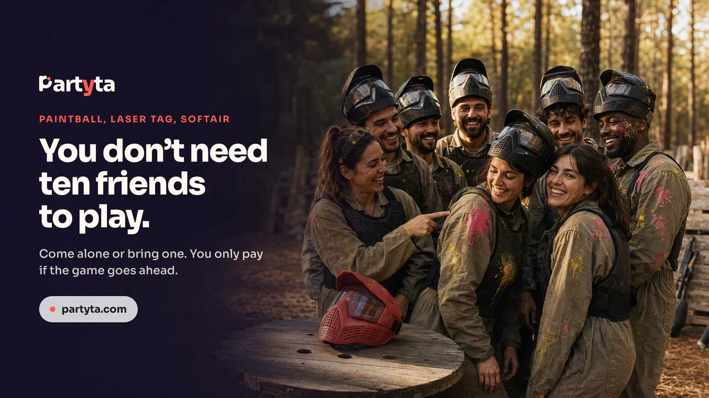
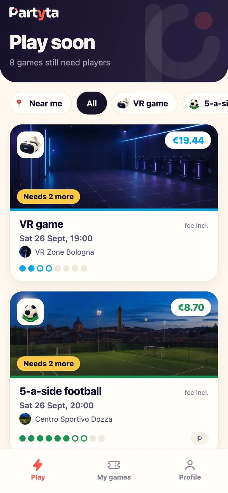
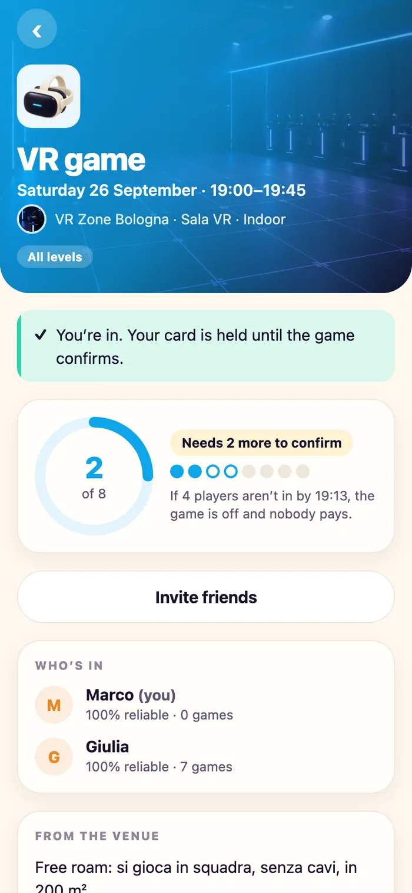
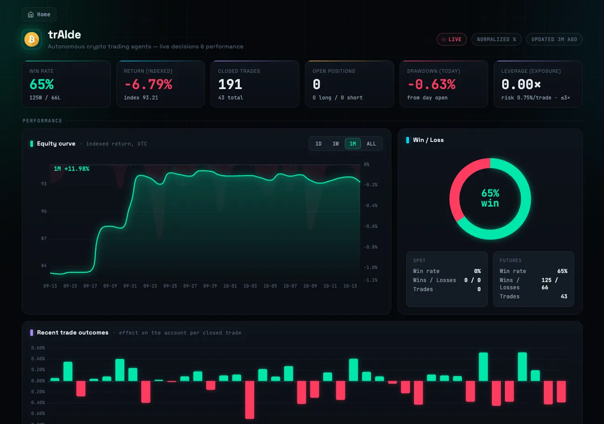
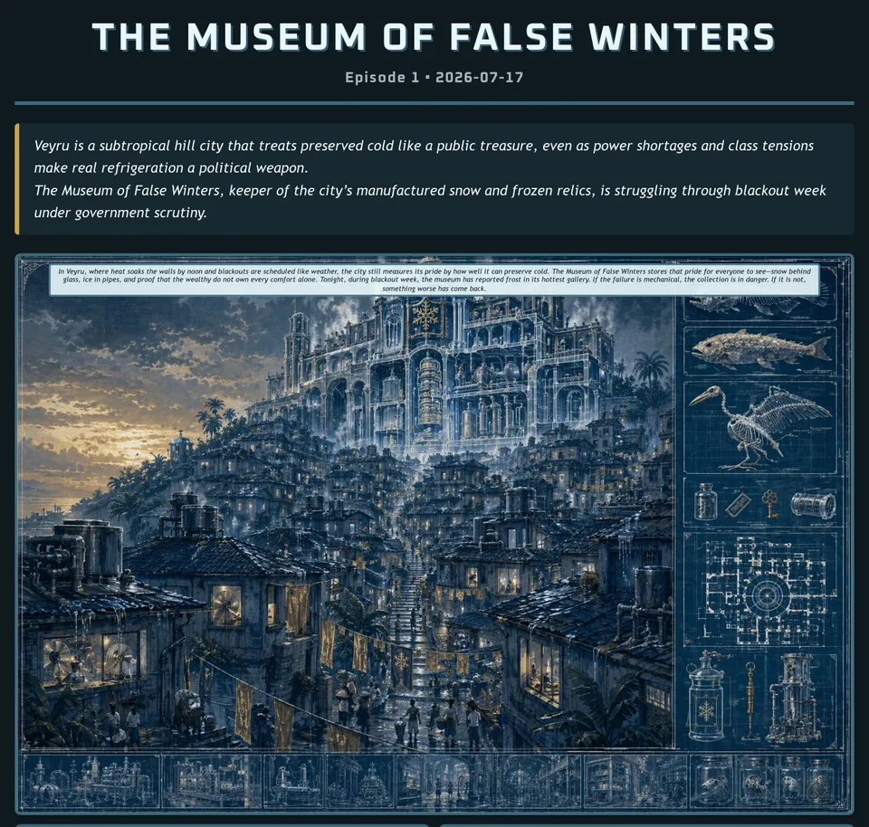
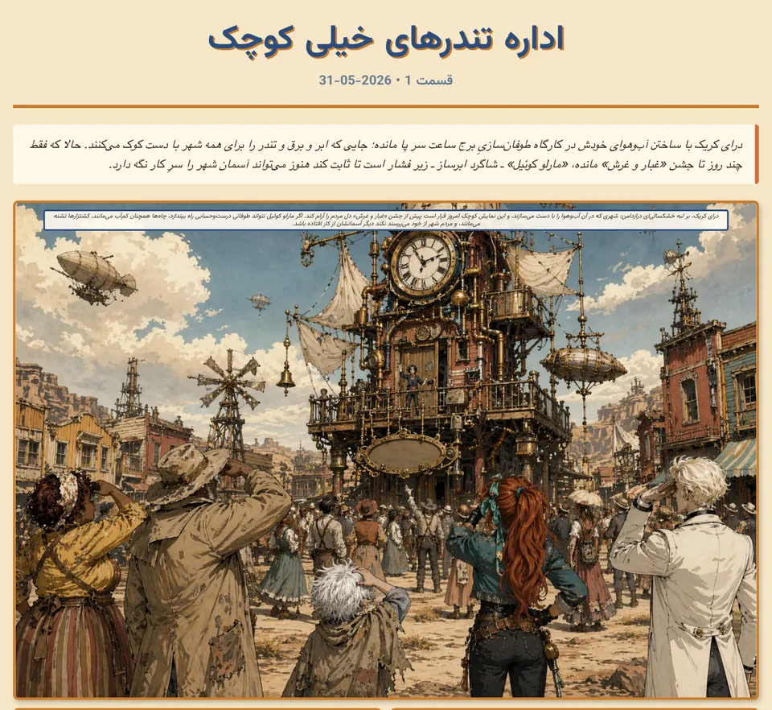
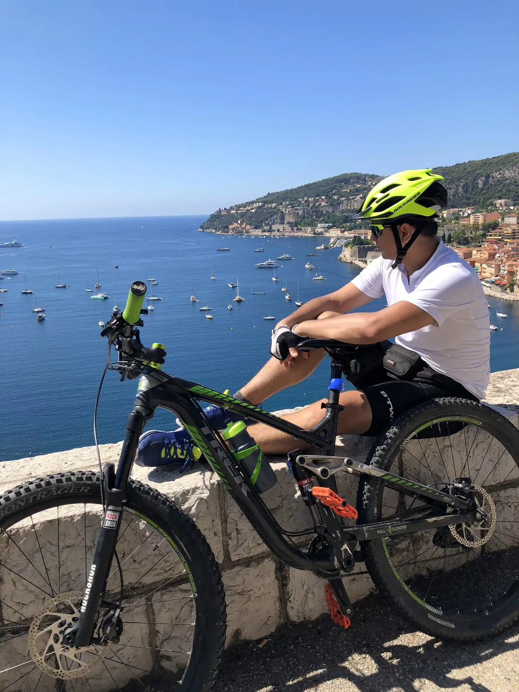
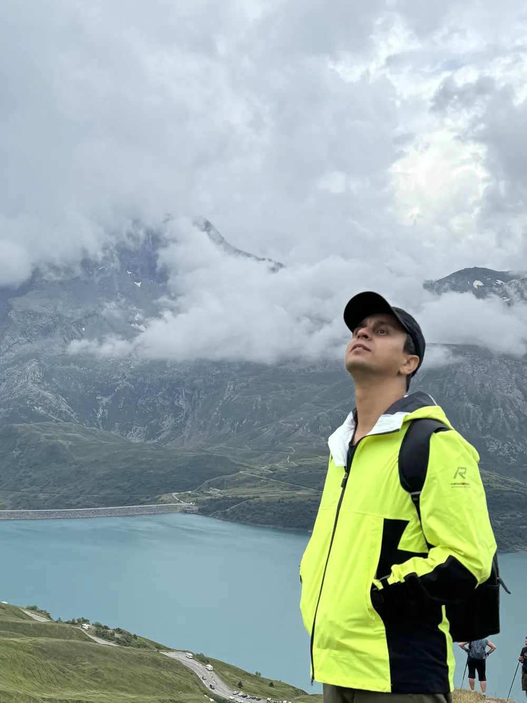
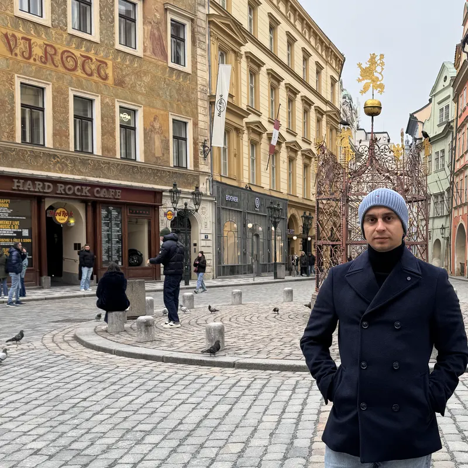

# Abozar Alizadeh

**Senior Software Engineer and Solution Architect in Milan.**
GenAI in production by day. A crew of AI agents by night.

🌐 **[abozaralizadeh.github.io](https://abozaralizadeh.github.io)** · [LinkedIn](https://www.linkedin.com/in/abozar-alizadeh) · [GitHub](https://github.com/abozaralizadeh) · [Twitter](https://x.com/abo0zar) · [Medium](https://abozar-alizadeh.medium.com) · [Reddit](https://www.reddit.com/user/ab0zar/) · [SandBox](https://sandboxes.live)


The story runs backwards: the newest work first, then how I got here.

---

<a id="now"></a>
## Now: one human and a crew of AI agents

After work I build [products](#products) on my own. My only team is a group of AI agents that I direct from a single control chat. They research, build, review each other's work and write the docs. I decide what to build, test everything on my own phone and own every commit.

> Put the AI only where the uncertainty is. Everything else should be boring code you can test.

**How I build**

1. **Build, review, ship.** One agent builds a feature, another reviews it like a tough critic, a third polishes it. All before I install anything.
2. **Measure everything.** Every feature ships with automated tests, and every claim is checked against real data before it goes out.
3. **One session per project.** Every product keeps its own long-lived agent session with its whole history. One Mission Control chat steers them all.
4. **Frugal by design.** No team to pay, no ad budget. Free cloud tiers, a Claude subscription and a lot of tests.
5. **Build in public.** Public repos, a [live trading dashboard](#traide) and [write-ups on Medium](#writing). Anyone can watch the work as it happens.
6. **Ship the story too.** Every product ships with a build diary, [demo films](#demo-recorder) and [social posts](#aism2), made mostly by my own agents and skills.

| 800 | 943 | 6 | 20 |
|:-:|:-:|:-:|:-:|
| contributions in the last 12 months | public commits | AI experiments running daily | articles written |

Public GitHub contributions per year: **55** (2020), **53** (2021), **10** (2022), **59** (2023), **74** (2024), **203** (2025), **757** (2026, up to 14 October).

---

## October 2026 · Coming soon

**Something I can't show you yet.** *There is more here than you can see.*
An idea I first wrote down in 2016. The technology finally caught up. → [parallelworlds.app](https://parallelworlds.app)

---

<a id="cronai"></a>
## October 2026 · CronAI: say it, don't cron it

**A neural network inside a TypeScript file.** A plain-English schedule picker for any website. A tiny 75k-parameter model lives in the source code and only fixes typos. A strict compiler writes the cron line, so it can't make anything up. On a typo benchmark, exact matches go from 16.9% to 93.8%. It also runs the schedules in [AISM²](#aism2).

[Code](https://github.com/abozaralizadeh/cronai) · [Widget builder](https://abozaralizadeh.github.io/cronai/) · [The article](https://javascript.plainenglish.io/i-put-a-neural-network-inside-a-typescript-file-to-kill-the-cron-expression-1e09c6a44e88)

---

<a id="products"></a>
## September 2026 · Two products, one night

One night in September I opened two agent sessions, sixty seconds apart: a booking platform for clinicians and a marketplace for group games. Three weeks later both were running, each with its own tests, legal research, films and build diary.

<a id="praxamo"></a>
### Praxamo: your practice, online · [praxamo.it](https://praxamo.it)


- **Their own site, their own name.** Every Italian clinician gets a professional website and online booking at *their-name*.praxamo.it. No marketplace in between: the patients you bring stay yours.
- **A dentist, a GP, a cardiologist.** Eight templates and eleven colour schemes, all contrast tested.
- **Regulation is the architecture.** Every page is checked against Italian health advertising law before it can go live.
- **Book without an account.** Patients book as guests; confirmations and reminders arrive in the practice's own name and colour.
- **A human looks first.** Nobody goes live until a human (me) has checked them against the official registers.
- **Tested like it matters.** 1,504 automated tests and 77 tenant isolation checks. Even the marketing film is a test.

[Watch the film (2:17)](assets/video/praxamo-film-en.mp4) · *The film uses an AI voice and sample data.*

<a id="partyta"></a>
### Partyta: any group game, one seat at a time · [partyta.com](https://www.partyta.com)



Paintball, laser tag, softair and VR need 10 to 24 players. Nobody sells those games seat by seat, so you end up chasing friends for days. On Partyta, venues publish open games and you join alone or with friends. Your card is only held, and it's charged only when the game reaches its minimum. If it never fills, nobody pays.

**What's inside:** a player app and website from one codebase, a console for venues, a group chat for every game, an iPhone build and 231 automated tests, in Italian and English. *In demo, payments simulated.*

| | |
|:-:|:-:|
|  |  |

[Watch the promo (1:23)](assets/video/partyta-promo-en.mp4) · *Synthetic voice; photos are AI-generated.*

<a id="demo-recorder"></a>
### demo-recorder: a camera crew for product demos · open source, MIT

Ask Claude for a demo video and it scripts it, records it with a smooth, visible cursor and captions, checks the result and hands you an MP4. The [Praxamo](#praxamo) and [Partyta](#partyta) films above were made with it. It exports MP4, GIF or WebM in 16:9, square or vertical.

```
/plugin marketplace add abozaralizadeh/ClaudeScreenRecordingSkill
/plugin install demo-recorder@abozaralizadeh
```

[Code on GitHub](https://github.com/abozaralizadeh/ClaudeScreenRecordingSkill)

---

<a id="aism2"></a>
## July 2026 · AISM²: an agent that runs social media


Write a brief and a schedule. When it's time, an agent researches the topic, makes an image or a short Sora 2 video, writes the caption and posts to Instagram, X, YouTube or TikTok. Or it waits for approval.

It runs in production every day and manages my own X, Instagram and YouTube. One example is [@genaicomicbook](https://www.instagram.com/genaicomicbook/), the Instagram page of the [ComicBook](#sandbox): AISM² posts every new episode and reel there by itself. Schedules are written in plain English with my own [CronAI widget](#cronai), and for every instruction I choose how much freedom the agent gets: post on its own, wait for my approval, or just rehearse in dry-run mode.

**2,242** automated tests · **21** live instructions · [Code on GitHub](https://github.com/abozaralizadeh/aismm)

---

<a id="traide"></a>
## December 2025 · trAIde: AI trading agents, with real money on the line

A research agent scans about 700 futures contracts and the news. A trading agent decides. A supervisor talks to me on Telegram. And plain code, not the model, owns the stops.

Since 30 September I've been running an experiment: **Jev vs Luna**. Jev, a second decision model, trades next to Luna, the original agent, on the same account and behind the same safety gates. Each is scored only on its own calls, and the public dashboard compares their decisions side by side.

> **Code enforces survival. The model owns opportunity.**



- **Built in public:** every decision, research note and supervisor note shows up live on a public dashboard.
- **Wide awake:** the research agent keeps a calendar of big economic releases and steps aside when they land.
- **Tested:** 1,360 automated tests guard the code between the model and the money.
- **Principle:** decisions follow the market. Nothing is hand-tuned to this week.

[Live dashboard](https://sandboxes.live/traide) · [Code on GitHub](https://github.com/abozaralizadeh/trAIde) · [The full story](https://abozar-alizadeh.medium.com/i-gave-my-ai-agent-70-and-my-exchange-keys-the-trading-was-the-easy-part-d23cdda52457) · *An experiment, not financial advice.*

---

## 2025 · Small, sharp tools I give away

- **pipup** ([PyPI](https://pypi.org/project/requp/) · [Code](https://github.com/abozaralizadeh/pipup)): `requirements.txt` that tells the truth. It pins your requirements to what's really installed and never adds anything new. The name pipup was taken on PyPI, so it ships as `requp`; both commands work.
- **Gen AI Advanced PR Reviewer** ([Marketplace](https://marketplace.visualstudio.com/items?itemName=abozar.GenAIAdvancedPRReviewer) · [Code](https://github.com/abozaralizadeh/azure-pipeline-gpt-pr-review)): AI code review on every Azure DevOps pull request, with inline comments, a security scan and an approve or request-changes call. 60 installs, rated 5.0.
- **UPPPDF** ([PyPI](https://pypi.org/project/upppdf/) · [Code](https://github.com/abozaralizadeh/UPPPDF)): unlocks password-protected PDFs where the encryption allows it.
- **Contributions merged upstream:** a Publish Flow feature in `microsoft/genaiops-promptflow-template`, and a contribution to `langchain-ai/langsmith-sdk`. GitHub achievement: **Pull Shark ×2**.

---

<a id="sandbox"></a>
## Since November 2024 · SandBox: AI experiments, shipped daily

[sandboxes.live](https://sandboxes.live) is a playground of autonomous agents that publish something new every day, all by themselves. Every experiment keeps its whole archive, and each page has a calendar to travel back in time.

- **[trAIde dashboard](https://sandboxes.live/traide):** a public window into my [trading agents](#traide).
- **[ComicBook](https://sandboxes.live/comicbook):** a comic that draws itself, one episode a day, in English, Italian and Persian, and on Instagram as [@genaicomicbook](https://www.instagram.com/genaicomicbook/). A Director plans each arc, a Storyteller writes, a Cartoonist draws, and native authors retell it in Italian and Persian without ever seeing the English. Every arc gets a new art style, researched by an Art Director agent.
- **[AI Open Problem Solver](https://sandboxes.live/ai-open-problem-solver):** an agent that works on the Riemann Hypothesis, P vs NP and the twin primes a little every day, with a memory of its dead ends.
- **[AI Blog](https://sandboxes.live/aiblog):** a blog that researches AI by itself and publishes an illustrated post every morning.
- **[Tomorrow News](https://sandboxes.live/tomorrownews):** tomorrow's newspaper, written today, in English, Persian and Italian. 580+ days of front pages, clearly marked as fiction.
- **[GenBox](https://sandboxes.live/genbox):** an imaginary AI government that researches the real world, makes one decision for humanity and produces its own TV bulletin with Sora 2, on a retro CRT.

| English | Italiano | فارسی |
|:-:|:-:|:-:|
|  |  |  |

*Three arcs, three languages, three native authors. Comic art is AI-generated.*

**Under the hood:** one Python app on Azure hosts every experiment. The agents are built with LangGraph, the OpenAI Agents SDK and deep agents on Azure OpenAI models, with Sora 2 for video and gpt-image for pictures. 6 live experiments · 580+ days of Tomorrow News · 24 comic arcs in 2026 · 3 languages.

---

## 2020 to 2023 · Before agents, there was plumbing

My personal open-source projects from before the agent era: chatbots, phone calls and monitoring, built on my own time and shared with everyone.

- **[AudioSocket.Net](https://github.com/abozaralizadeh/AudioSocket.Net)** (2023): streams live phone-call audio out of Asterisk into .NET, the plumbing behind real-time voice bots.
- **[offline-directline](https://github.com/abozaralizadeh/offline-directline)** (2022): a Bot Framework Direct Line emulator, shipped in Docker, so chatbots can be tested without the cloud.
- **[ApiWatchTower](https://github.com/abozaralizadeh/ApiWatchTower)** (2021): my first public tool. Calls your APIs on a schedule and alerts on downtime or when the response payload quietly changes. 4,790 Docker pulls.
- **[async-lock](https://github.com/rogierschouten/async-lock)** (2021): a `maxOccupationTime` option I added to this widely used Node.js library, shipped in version 1.3.0.

10.7k Docker pulls · 34 public repos · 2 PyPI packages · [Docker Hub](https://hub.docker.com/u/abo0zar) · [All repos](https://github.com/abozaralizadeh?tab=repositories)

---

<a id="writing"></a>
## Writing: I write about what I build

20 articles on Medium, six of them published by Towards AI: generative AI in production, AI agents, and the [experiments](#sandbox) above.

| Date | Article | Published in |
|:-|:-|:-|
| Oct 2026 | [I Put a Neural Network Inside a TypeScript File to Kill the Cron Expression](https://javascript.plainenglish.io/i-put-a-neural-network-inside-a-typescript-file-to-kill-the-cron-expression-1e09c6a44e88) | JavaScript in Plain English |
| Sep 2026 | [I Gave my AI Agent $70 and My Exchange Keys. The Trading Was the Easy Part.](https://abozar-alizadeh.medium.com/i-gave-my-ai-agent-70-and-my-exchange-keys-the-trading-was-the-easy-part-d23cdda52457) | Medium |
| Aug 2026 | [Round-Robin Broke My Agent](https://pub.towardsai.net/round-robin-broke-my-agent-dda6885c0a25) | Towards AI |
| Jun 2026 | [The Comic That Draws Itself: Building a Daily AI Graphic-Novel Studio](https://pub.towardsai.net/the-comic-that-draws-itself-building-a-daily-ai-graphic-novel-studio-da4f7a61e39c) | Towards AI |
| Jun 2026 | [Tomorrow News Speaks Three Languages: How AI Reports the Future in Multiple Languages](https://abozar-alizadeh.medium.com/tomorrow-news-speaks-three-languages-how-ai-reports-the-future-in-multiple-languages-473f2303b284) | Medium |
| Jun 2026 | [Giving the AI Government a Face and a Voice: Building GenBox's Self-Producing Newsroom](https://abozar-alizadeh.medium.com/giving-the-ai-government-a-face-and-a-voice-building-genboxs-self-producing-newsroom-db7f57b9e1c7) | Medium |
| Dec 2025 | [A Developer's Guide to Agentic Frameworks in 2026](https://pub.towardsai.net/a-developers-guide-to-agentic-frameworks-in-2026-3f22a492dc3d) | Towards AI |
| Dec 2025 | [Productionizing Azure ML PromptFlow Part II: Real-World Autoscaling Challenges in AKS](https://abozar-alizadeh.medium.com/productionizing-azure-ml-promptflow-part-ii-real-world-autoscaling-challenges-limitations-and-1495b54d2b11) | Medium |
| Dec 2025 | [Productionizing Azure ML PromptFlow Part I: Architecting for Scale, Stability, and Cost Efficiency](https://abozar-alizadeh.medium.com/productionizing-azure-ml-promptflow-part-i-architecting-for-scale-stability-and-cost-efficiency-26abe7c65b5c) | Medium |
| Nov 2025 | [Advanced Azure DevOps Pull Request Reviewer Agent](https://pub.towardsai.net/advanced-azure-devops-pull-request-reviewer-agent-7e2e6cbcfa83) | Towards AI |
| Oct 2025 | [Can My Autonomous AI Agent Solve a Millennium Problem and Win $1,000,000?](https://pub.towardsai.net/can-my-autonomous-ai-agent-solve-a-millennium-problem-and-win-1-000-000-3ff8fff8a786) | Towards AI |
| Sep 2025 | [The Python Package Manager That Finally Gets Requirements.txt Right: Introducing pipup](https://abozar-alizadeh.medium.com/the-python-package-manager-that-finally-gets-requirements-txt-right-introducing-pipup-5e0436e7ab2a) | Python in Plain English |
| Sep 2025 | [From Experiment to Essential: Why AIBlog (an AI That Researches AI) Has Become My Daily Compass](https://abozar-alizadeh.medium.com/from-experiment-to-essential-why-aiblog-an-ai-that-researches-ai-has-become-my-daily-compass-730126a59fc7) | Towards AI |
| Jun 2025 | [Recursive Intelligence: An AI Agent That Researches and Writes About AI Autonomously](https://medium.com/design-bootcamp/recursive-intelligence-an-ai-agent-that-researches-and-writes-about-ai-autonomously-100bccd81001) | Bootcamp |
| Jun 2025 | [The Kubernetes Overprovisioning Playbook: How a Simple "Pause" Pod Can Eliminate Scaling Delays in AKS](https://abozar-alizadeh.medium.com/the-kubernetes-overprovisioning-playbook-how-a-simple-pause-pod-can-eliminate-scaling-delays-in-0ec95688dbe3) | Medium |
| Jan 2025 | [Tomorrow News: How AI Crafts Future's Headlines and Stories](https://ai.gopubby.com/tomorrow-news-how-ai-crafts-futures-headlines-and-stories-8f2b37fd841e) | AI Advances · editors' pick |
| Dec 2024 | [Automating Azure API Management Deployments with AzureDevOpsAPIM](https://abozar-alizadeh.medium.com/automating-azure-api-management-deployments-with-azuredevopsapim-d0c850283447) | Medium |
| Dec 2024 | [Building High-Performance Audio Streaming with AudioSocket.Net](https://abozar-alizadeh.medium.com/building-high-performance-audio-streaming-with-audiosocket-net-2edf1553d882) | Medium |
| Dec 2024 | [Exploring AI-Driven Governance: Building a Virtual World Where AI Rules](https://abozar-alizadeh.medium.com/exploring-ai-driven-governance-building-a-virtual-world-where-ai-rules-22419690a409) | Medium |
| Jan 2021 | [Api Watch Tower](https://abozar-alizadeh.medium.com/api-watch-tower-7f222f1e0eb4) | Medium |

---

## About me · 2020 to now: by day, I put generative AI into production

At Vodafone Italia I grew from Senior Software Engineer (2020) to Technical Lead (2022) to Solution Architect and Team Leader (2023). Today I work as a Lead Architect on AI agents and LLMOps.

The project I'm proudest of: bringing generative AI into **TOBi**, Vodafone's virtual assistant, and into the tools the human agents use behind it. I led it from the first idea all the way to production.

- **GenAI that scales:** Azure Machine Learning, Prompt Flow and LangChain, designed for real traffic.
- **Shaping the tools:** I worked directly with Microsoft product teams; my feedback and code went into Azure ML networking, Prompt Flow and the GenAIOps templates.
- **From notebook to prod:** pipelines that take prompts and models from an experiment to production safely, again and again.
- **A team of nine:** I lead and mentor an international team of engineers, and help hire the next ones.

10+ years in software · 9 engineers led · 3 clouds (Azure, AWS, GCP) · Kubernetes certified (CKAD)

`Azure ML` `Prompt Flow` `LangChain` `LangGraph` `OpenAI Agents SDK` `AKS` `API Management` `Front Door` `Cosmos DB` `Kubernetes` `Terraform` `Python` `C# / .NET` `Django` `Flask` `Redis` `PostgreSQL` `GCP` `AWS`

---

## About me · rewind to 2006

**Before Milan: three cities, three languages, one habit of making things.** From Tehran to Milan, 4,025 km.

- **2016 to 2019 · Turin.** R&D, chatbots before they were cool. At BYTERS I built a Wit.ai chatbot for Yamaha Motor Italy, an Android NDK app that tags objects in live video with OpenCV, and an OCR receipt reader. Then, as Solution Architect at Djungle, I designed data pipelines and gamified products on Google Cloud.
- **2013 to 2016 · Turin.** A new country, a new alphabet. **Master of Science in Computer Engineering and Communication Networks, Politecnico di Torino.** My thesis measured the distance between Android phones using Wi-Fi Direct.
- **2006 to 2012 · Hamedan.** Learning how machines talk. **Bachelor of Science in Computer Engineering (Software), Bu-Ali Sina University**, with a thesis that simulated backoff algorithms in ad hoc networks. On the side I supported live camera image processing software at Famori.
- **2006 · Tehran.** And at the very beginning, I started in 3D: modelling and animating for children's programmes at IRIB, Iran's national TV. For six years I also taught 3ds Max, V-Ray, Flash and C++ to anyone who wanted to learn.

I speak فارسی, English and Italiano.

---

## Offline

Milan is home. Weekends are for bikes, mountains, trips and a good view.

| | | |
|:-:|:-:|:-:|
|  |  |  |
| Côte d'Azur, by bike | Lac du Mont-Cenis | Kinderdijk at sunset |
|  |  |  |
| Portofino | Prague, Old Town | Siena |

---

## Say hello

I'm always up for a chat about AI agents, architecture, or a side project that deserves to ship.

[LinkedIn](https://www.linkedin.com/in/abozar-alizadeh) · [GitHub](https://github.com/abozaralizadeh) · [Twitter @abo0zar](https://x.com/abo0zar) · [Medium](https://abozar-alizadeh.medium.com) · [Reddit u/ab0zar](https://www.reddit.com/user/ab0zar/) · [sandboxes.live](https://sandboxes.live)

<sub>© 2026 Abozar Alizadeh · Built with my AI agents, one session at a time. Images marked AI-generated were made with AI. Product shots use sample data.</sub>
