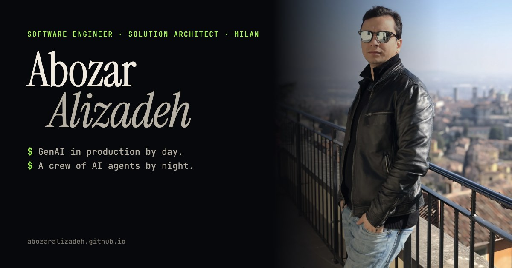

# abozaralizadeh.github.io

My personal site: a scrollytelling story about me and the things I build, newest first.

**Live:** https://abozaralizadeh.github.io



## What's inside
- A dark, cinematic single page in plain HTML, CSS and vanilla JS. No framework, no build step.
- Scroll scenes: a map that rewinds from Milan to Tehran, a video opener scrubbed frame by frame, sticky galleries of a comic that draws itself, a live CronAI widget, and a lens that hides something I can't show yet.
- Respects `prefers-reduced-motion`: everything stays readable without animation.

## Run it locally
```bash
python3 -m http.server 8765
```
Then open http://127.0.0.1:8765.

Built by me and my AI agents. Images marked AI-generated were made with AI.
